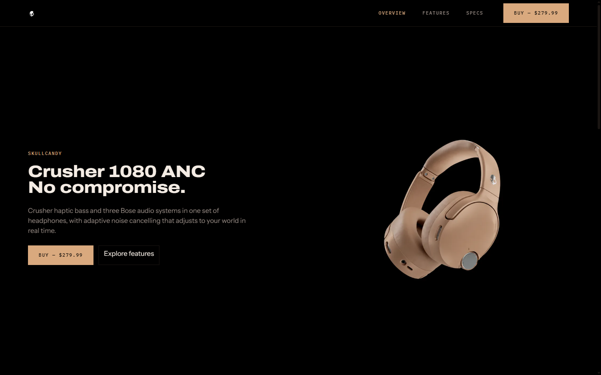
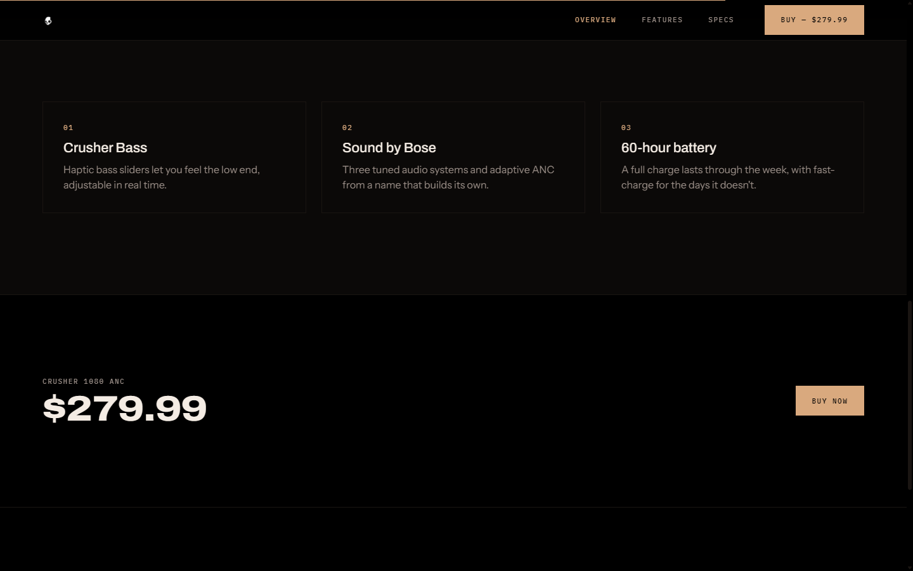
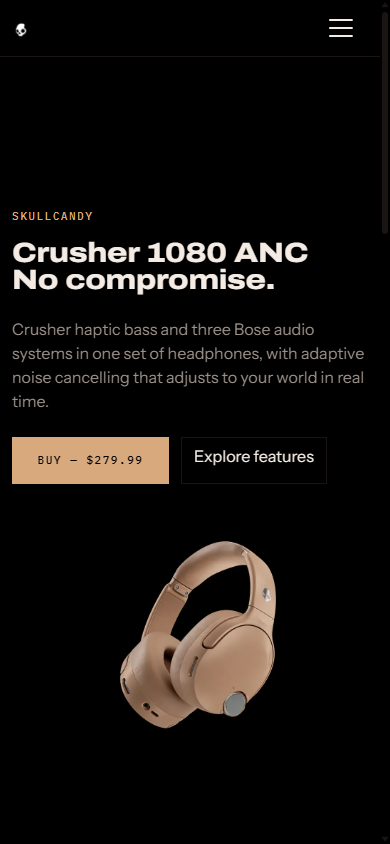

# Skullcandy Bootstrap Site

A four-page static Skullcandy product site built with plain HTML, CSS, and
JavaScript, styled with vendored Bootstrap 5.3.3. There is no build step,
no package manager, and no dependency on network access — everything the
site needs (Bootstrap, fonts, and images) is vendored locally under
`vendor/` and `assets/`.

## Requirements

None. No Node, no bundler, no internet connection. Just a browser (and
optionally Python, for serving the files over HTTP).

## Viewing the site

Either:

- Open `index.html` directly in a browser (`file://`), or
- Serve it locally and browse to `http://localhost:8000`:

  ```
  py -m http.server 8000
  ```

Serve it over HTTP to see the page transitions. Cross-document View
Transitions require two same-origin documents, and every `file://` URL is
its own opaque origin, so opening the files directly navigates plainly
instead. Nothing else differs.

## Structure

- `assets/` — product imagery and the 121-frame teardown sequence, copied
  unmodified from the source design (already crushed to true black; do not
  re-encode).
- `css/motion.css` — page transitions and scroll-driven reveals, in pure
  CSS with no JavaScript. The navbar, footer, page heading and product
  render morph between pages while the page body racks into focus behind
  them, and section content reveals against scroll position. All of it is
  enhancement on top of a site that is complete without it: the View
  Transitions are inert on `file://` and in Firefox, the scroll reveals
  sit behind `@supports`, and `prefers-reduced-motion` switches off every
  rule in the file.
- `vendor/bootstrap/` — Bootstrap 5.3.3 CSS and JS bundle, vendored locally.
- `vendor/fonts/` — Archivo (variable, wdth/wght), Instrument Sans
  (variable, wght), and IBM Plex Mono (weight 500), vendored locally with
  `fonts.css`.

## Screenshots






